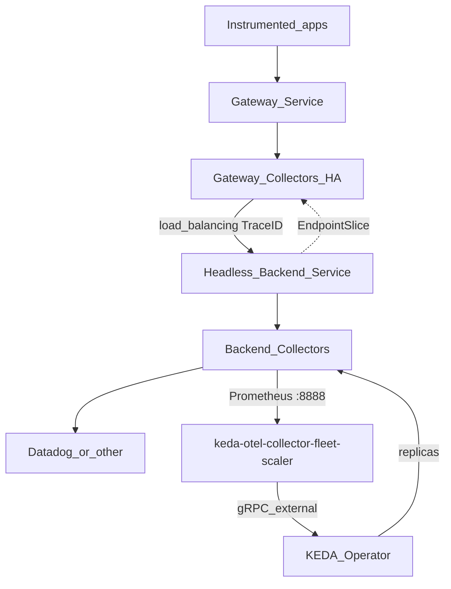

# Architecture

## Problem

Single-instance OpenTelemetry Collectors are a SPOF and often hit memory pressure.
Autoscaling backends is hard because TraceID affinity and membership discovery are
easy to get wrong with ad-hoc solutions.

## Solution

Reuse the upstream TraceID `load_balancing` exporter for routing and discovery.
Add a **KEDA external scaler** that scrapes collector self-telemetry and drives
backend replica count, plus **fleet profiles** that encode safe join/leave behavior.

## Components

| Component | Role |
|---|---|
| `cmd/scaler` | gRPC ExternalScaler + Prometheus scraper |
| Gateway collectors | OTLP ingest + TraceID route |
| Backend collectors | User `config.yaml` (forward or stateful) |
| Helm chart / examples | Wire Service, RBAC, ScaledObject, profiles |

## Docs map

- [Metric contract](metric-contract.md) — scrape path and ScaledObject metadata
- [Fleet profiles](fleet-profiles.md) — `forward` vs `stateful`
- [Scale safety](scale-safety.md) — join/leave and ring behavior
- [Community packaging](community-packaging.md) — repo layout and contribution

## Non-goals

- Custom TraceID load balancer
- Auto-detecting processors from `config.yaml`
- Multi-cluster membership consensus
- Scaling applications from APM metrics (see Kedify OTel add-on)
