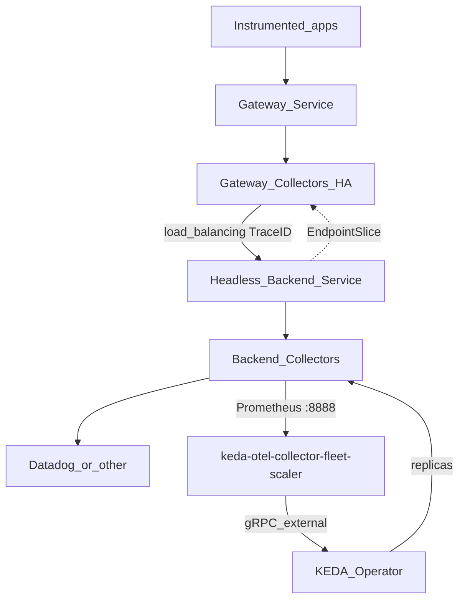

# Architecture

## Problem

Single-instance OpenTelemetry Collectors are a SPOF and often hit memory pressure.
Autoscaling backends is hard because TraceID affinity and membership discovery are
easy to get wrong with ad-hoc solutions.

## Solution

Reuse the upstream TraceID `load_balancing` exporter for routing and discovery.
Add a **KEDA external scaler** that scrapes collector self-telemetry and drives
backend replica count, plus **fleet profiles** that encode safe join/leave behavior.

## Components

| Component | Role |
|---|---|
| `cmd/scaler` | gRPC ExternalScaler + Prometheus scraper |
| Gateway collectors | OTLP ingest + TraceID route |
| Backend collectors | User `config.yaml` (forward or stateful) |
| Helm chart / examples | Wire Service, RBAC, ScaledObject, profiles |
| Gateway Service | ClusterIP by default (BYO-compatible); optional dedicated `LoadBalancer` or AWS LBC `TargetGroupBinding` for external OTLP (`4317`/`4318` only) |

## Docs map

- [Metric contract](metric-contract.md) — scrape path and ScaledObject metadata
- [Fleet profiles](fleet-profiles.md) — `forward` vs `stateful`
- [Scale safety](scale-safety.md) — join/leave and ring behavior
- [Community packaging](community-packaging.md) — repo layout and contribution

## External OTLP access

| Mode | Service type | How clients reach the gateway |
|------|--------------|-------------------------------|
| In-cluster only | `ClusterIP` (default) | `otel-gateway.<ns>.svc:4317` / `:4318` |
| **BYO LB** (preferred for existing NLB) | `ClusterIP` + `TargetGroupBinding` | Existing AWS NLB → TG → pods (AWS LBC) |
| **Dedicated LB** | `type: LoadBalancer` | Cloud controller provisions a new NLB/ILB |

BYO keeps LB lifecycle outside the chart: platform owns the NLB and target groups;
the chart only creates ClusterIP Service + optional `TargetGroupBinding` CRs.
See [BYO Load Balancer](byo-load-balancer.md), Helm values
`fleet.gateway.targetGroupBinding`, and `deploy/examples/byo-lb`.

**Why not Ingress / ALB?** Raw OTLP is L4 (gRPC and HTTP/protobuf on fixed ports
4317/4318). ALB/Ingress path-based HTTP routing does not map cleanly to that
contract — use an NLB (or equivalent L4 LB), not an Application Load Balancer.

Never expose the scaler gRPC port (`:9090`) on any external LB.

## Non-goals

- Custom TraceID load balancer
- Auto-detecting processors from `config.yaml`
- Multi-cluster membership consensus
- Scaling applications from APM metrics (see Kedify OTel add-on)
