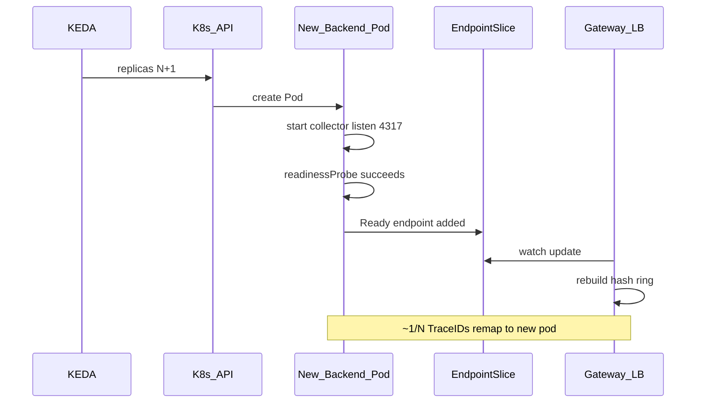
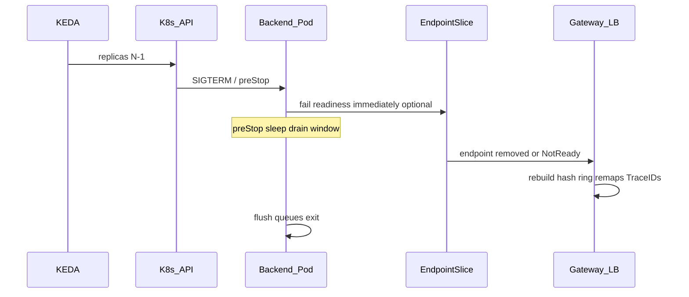

# Scale Safety (Hash Ring Membership)

Gateway collectors route by TraceID using the upstream `load_balancing` exporter.
Membership comes from Kubernetes EndpointSlices (or DNS) for the backend Service.
KEDA only changes replica count; this document defines the **join/leave** sequence
so routing stays as consistent as practical during scale events.

## Assumptions

1. Gateway uses `resolver.k8s` against a headless backend Service (preferred) or
   `resolver.dns` with a short refresh interval (≤ `5s`).
2. The exporter skips endpoints with `conditions.ready == false`.
3. Consistent hashing remaps roughly `1/N` of TraceIDs when membership changes by one.
4. Multiple gateway replicas may briefly disagree on membership during updates;
   EndpointSlice watches minimize that window vs DNS.

These are inherent to the upstream design; this project documents and encodes
operational mitigations rather than adding cluster-wide consensus.

## Join sequence (scale-out)



### Requirements

| Control | Encoding |
|---|---|
| Do not accept traffic until ready | `readinessProbe` on OTLP port (TCP `4317`) |
| Stay out of ring until Ready | Default Service EndpointSlice behavior; do **not** set `publishNotReadyAddresses: true` on the backend Service used by the resolver |
| Limit remap churn | Profile HPA scale-up policies (1–2 pods per period) |

## Leave sequence (scale-in)



### Requirements

| Control | Encoding |
|---|---|
| Drain before exit | `lifecycle.preStop` sleep ≥ profile drain (`forward`: 15s, `stateful`: ≥ `decision_wait`) |
| Grace period | `terminationGracePeriodSeconds` > `preStop` + flush time |
| Soften ring thrash | HPA scale-down stabilization (`forward`: 60s, `stateful`: 300s) |
| Avoid sending to dead pods | Prefer failing readiness early in `preStop` so EndpointSlice drops the member before process exit; enable LB exporter queue/retry for residual failures |

### Recommended `preStop`

Prefer Kubernetes SleepAction (1.30+) so distroless collector images work:

```yaml
lifecycle:
  preStop:
    sleep:
      seconds: 15   # forward default; stateful: >= decision_wait
```

Optionally fail readiness earlier via a custom sidecar/wrapper so EndpointSlice
drops the member before the sleep completes.

For `stateful` profiles, set `PRE_STOP_SECONDS` to at least
`tail_sampling.decision_wait` (plus a few seconds). Spans still in memory on the
terminating pod should be exported or accepted as loss within the documented
upstream trade-off.

## Gateway resiliency settings

Enable resiliency on the `load_balancing` exporter so topology changes can
re-route after sub-exporter retries exhaust:

```yaml
exporters:
  load_balancing:
    timeout: 30s
    sending_queue:
      enabled: true
      num_consumers: 10
      queue_size: 1000
    retry_on_failure:
      enabled: true
      initial_interval: 1s
      max_interval: 30s
      max_elapsed_time: 300s
    protocol:
      otlp:
        timeout: 10s
        sending_queue:
          enabled: true
        retry_on_failure:
          enabled: true
    resolver:
      k8s:
        service: otel-backends.observability
        ports:
          - 4317
```

## Split-trace risk

During scale events, spans of one TraceID can briefly land on different backends.
Impact:

| Backend config | Impact |
|---|---|
| `forward` to Datadog | Usually low; Datadog reassembles by TraceID |
| Tail sampling / local decisions | Sampling decisions may disagree; incomplete traces |

Mitigations: slow scale velocity, long drain for stateful, `groupbytrace` before
`load_balancing` on the gateway when atomic dispatch matters, keep gateway DNS
interval low if not using k8s resolver.

## Test checklist

- [ ] Scale 2→3: new pod Ready before receiving traffic; ring size = 3
- [ ] Scale 3→2: EndpointSlice drops member before process exit; no sustained export errors
- [ ] Kill a backend: gateways stop hashing to it after Ready=false; queued retries succeed or drop within policy
- [ ] Two gateways: EndpointSlice views converge within a few seconds of scale event
